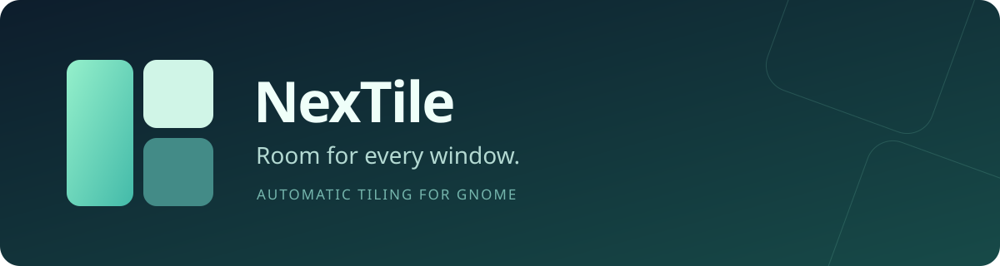
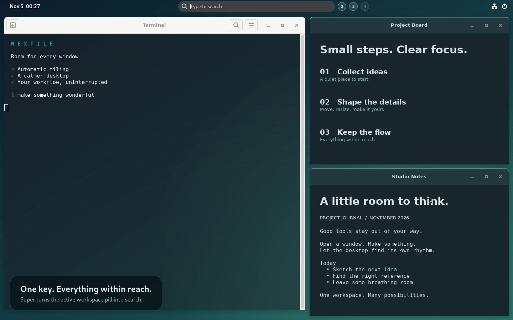

<p align="center">
  
</p>

<p align="center">
  <a href="https://github.com/erikleblansch/NexTile/releases/latest"></a>
  <a href="docs/COMPATIBILITY.md"></a>
  <a href="https://github.com/erikleblansch/NexTile/actions/workflows/check.yml"></a>
  <a href="LICENSE"></a>
</p>

**An automatic tiling extension that feels at home in GNOME.** Open a window and NexTile makes room. Drag a boundary to reshape your layout. Press Super and your workspace pill becomes a search bar.

No configuration files to learn. Your controls live in Quick Settings.

<p align="center">
  <a href="https://erikleblansch.github.io/NexTile/">
    
  </a>
  <br>
  <a href="https://erikleblansch.github.io/NexTile/"><strong>▶ Watch the demo in your browser</strong></a> · <a href="https://github.com/erikleblansch/NexTile/releases/latest">Download NexTile</a>
</p>

The video is a real GNOME session with synthetic demo content. The player supports pause, seeking and fullscreen; no download or account is required. [Video and recording details](docs/DEMO.md).

## A desktop that makes room

- **Automatic tiling.** Each new window splits the largest available tile along its longest side. Close or minimize a window and its neighbors reclaim the space.
- **Drag to reshape.** Resize adjoining tiles by dragging their shared boundary. Drop a window onto another tile to split that tile; the remaining windows fill the space you leave behind.
- **A quieter top bar.** Transparent background, a clock on the left, and centered, numbered workspaces. Text changes between black and white to suit the background underneath.
- **Search without leaving your work.** Super expands the active workspace pill into a search field. Native GNOME app and provider results appear over your desktop, with translucent category cards. Scroll to change workspaces while keeping your query.
- **Open another window.** Launch a running app again to request a new window. The **Always open a new window** switch controls this behavior in search, the dash and the app grid. [Details](docs/NEW-WINDOW-LAUNCH.md).
- **Your preferences, close at hand.** One Quick Settings toggle turns tiling on or off. Its arrow opens gaps, split direction, floating windows, top bar, search and terminal controls.
- **Eleven languages, automatically.** English, Nederlands, Deutsch, Français, Español, Português, Italiano, Polski, 日本語, 简体中文 and Українська follow your GNOME session language. Other languages fall back to English.

Each workspace and monitor has its own layout. Fullscreen, deliberate maximization and floating windows remain available. Applications that restore a maximized startup state are returned to normal tiled geometry.

## Install

Requires **GNOME Shell 46, 47, 48, 49, 50 or 51**. See the [compatibility and test matrix](docs/COMPATIBILITY.md) for the tested versions and session types. Disable other automatic tiling extensions before enabling NexTile.

1. Download **`nextile@erikleblansch.github.io.shell-extension.zip`** from the [latest release](https://github.com/erikleblansch/NexTile/releases/latest).
2. Install the downloaded file:

   ```sh
   gnome-extensions install --force ~/Downloads/nextile@erikleblansch.github.io.shell-extension.zip
   ```

3. Log out and back in, then enable NexTile in the **Extensions** app, or run:

   ```sh
   gnome-extensions enable nextile@erikleblansch.github.io
   ```

Open Quick Settings at the top right. Turn **NexTile** on and use its arrow to adjust the layout. Updating uses the same steps; log out and back in so GNOME loads the new JavaScript.

To remove NexTile:

```sh
gnome-extensions disable nextile@erikleblansch.github.io
gnome-extensions uninstall nextile@erikleblansch.github.io
```

If you enabled terminal transparency, turn **Transparent terminal** off before uninstalling. This optional GTK preference persists independently of whether tiling or the extension is running.

## Make it yours

| Quick Settings control | What it does |
| --- | --- |
| NexTile | Enable or disable automatic tiling |
| Window gaps | Choose 0, 4, 8, 12, 16, 24 or 32 logical pixels |
| Split direction | Automatic, side by side or stacked |
| ⚠ Float active window | Exclude or rejoin the last focused application window |
| Reflow windows | Rebuild the current layouts |
| Restore windows when tiling is off | Restore saved sizes and positions on disable |
| Transparent top bar | Enable the adaptive panel and numbered workspace ribbon |
| Super opens search | Replace the usual Super overview with in-panel search |
| Always open a new window | Launch another window from search, the dash or app grid; enabled by default |
| Transparent terminal | Enable a 50% background for **GNOME Terminal (GTK 3)** |

**Terminal transparency:** close all GNOME Terminal windows and reopen Terminal after changing the switch. In the Terminal profile, enable **Use colors from system theme**. On Ubuntu versions offering **Use transparency from system theme**, leave that option enabled too. NexTile detects that Terminal variant automatically. The text stays fully opaque. NexTile adds a marked block to `~/.config/gtk-3.0/gtk.css`, preserves your other CSS and creates a backup before each change. Existing transparency from NexTile 0.5 is detected on upgrade. This option does not configure Console, Ptyxis, other terminals or Flatpak sandbox overrides. [Manual removal helper](tools/configure-terminal.py): `python3 tools/configure-terminal.py --remove`.

| Gesture or key | Action |
| --- | --- |
| Super | Open or close compact search |
| Type, then Enter | Search and launch on the selected workspace |
| ↑ / ↓ or Tab / Shift+Tab | Select a search result |
| Scroll while searching | Move between workspaces without losing your query |
| Escape or click outside search | Close search |
| Click a workspace number | Switch workspace |
| Click the active workspace pill | Open the full GNOME overview |
| Drag a shared tile boundary | Resize neighboring tiles together |
| Escape while dragging a boundary | Restore the previous split |
| Drag a title bar onto another tile | Insert the window by splitting the destination |

The standard overview and GNOME shortcuts remain available. Search providers and their languages follow GNOME and the applications you have installed.

## Built to stay out of the way

NexTile uses a binary split tree and responds to window, monitor and workspace events. Layout changes are coalesced; there is no continuous tiling loop. The adaptive panel samples two rows of compositor pixels in memory when the desktop changes. It does not save or transmit screenshots. Search uses your existing GNOME providers and does not send queries to a NexTile service. Activating a result that supplies text, such as a character, copies that text to the clipboard; NexTile never reads the clipboard.

GNOME extensions run inside the desktop shell, so compatibility deserves more than a version number in metadata. NexTile includes pure geometry tests and a real compositor test harness for window creation, dragging, search, workspaces and cleanup. See [validation evidence and known limits](docs/VALIDATION.md).

## Distribution

NexTile is distributed through [GitHub Releases](https://github.com/erikleblansch/NexTile/releases/latest). Install and update it using the ZIP instructions above. Publication on extensions.gnome.org is no longer planned. [Submission history](docs/SUBMISSION.md).

## Build and contribute

Install `gjs`, `glib-compile-schemas`, GNU `gettext`, Python 3 and Make, then:

```sh
git clone https://github.com/erikleblansch/NexTile.git
cd NexTile
make test
make pack
make install
```

`make pack` creates a reproducible ZIP in `dist/`, including schema XML and compiled translations; GNOME compiles the settings during installation. It excludes the demo, tests and development tools. For the JavaScript lint check, install Node.js 20.19+, 22.13+ or 24+, then run `npm ci --ignore-scripts && npm run lint`.

For isolated runtime tests, install GNOME Shell, GTK 3 Python bindings, GNOME Terminal and D-Bus; X11 testing also needs Xephyr:

```sh
bash tests/runtime.sh wayland  # two virtual monitors; separate settings and session bus
bash tests/runtime.sh x11     # GNOME 48 in Xephyr
```

Reports go to a new `/tmp/nextile-runtime.*` directory. The harness never replaces your running Shell. [Contribution guide](CONTRIBUTING.md) · [Report a bug](https://github.com/erikleblansch/NexTile/issues/new?template=bug_report.yml) · [Suggest an improvement](https://github.com/erikleblansch/NexTile/issues)

If NexTile makes your desktop more comfortable, a star helps other GNOME users find it.

## License

[GPL-3.0-or-later](LICENSE). Built with GNOME Shell, Mutter, GJS and the GNOME community’s extension APIs.
