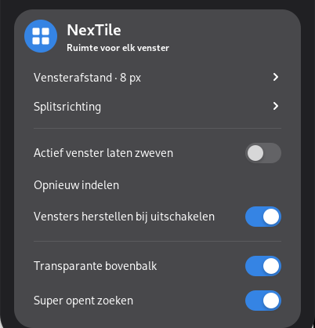
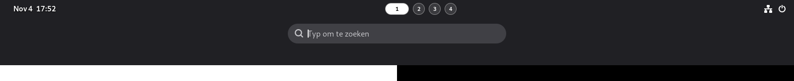

# NexTile

**Ruimte voor elk venster.** Een kleine automatische tiling-extensie voor GNOME Shell 48.

NexTile deelt bij een nieuw venster de **grootste tegel in tweeën**. De overige tegels blijven staan. Sluit je een venster, dan vult de overgebleven buur de ruimte. Alles is bereikbaar vanuit één knop in GNOME Quick Settings.



Vanaf **0.2.0** heeft NexTile ook een transparante bovenbalk: de klok staat links, genummerde werkruimtes staan in het midden en tekst en pictogrammen kiezen automatisch zwart of wit op basis van de zichtbare achtergrond.


Vanaf **0.3.0** opent één druk op **Super** een compacte zoekbalk die vanuit de actieve werkruimtepil groeit. Het bureaublad blijft zichtbaar. Typ meteen een programmanaam en wissel tijdens het zoeken met het muiswiel van werkruimte.



```text
       1 venster             2 vensters            3 vensters
    ┌─────────────┐      ┌──────┬──────┐       ┌──────┬──────┐
    │             │      │      │      │       │  1   │      │
    │      1      │  →   │  1   │  2   │   →   ├──────┤  2   │
    │             │      │      │      │       │  3   │      │
    └─────────────┘      └──────┴──────┘       └──────┴──────┘
```

## Installeren

Download het `.shell-extension.zip`-bestand bij [Releases](https://github.com/erikleblansch/NexTile/releases/latest) en installeer het:

```sh
gnome-extensions install --force nextile@erikleblansch.github.io.shell-extension.zip
```

Log uit en weer in, en schakel de extensie in:

```sh
gnome-extensions enable nextile@erikleblansch.github.io
```

Vanuit deze repository kan het ook met `make install`. Daarvoor zijn Python 3, GJS, GLib-tools en `gnome-extensions` nodig. Er zijn geen npm-pakketten of achtergrondservices.

## Bediening

Open het systeemmenu rechtsboven. Klik op **NexTile** om automatisch tegelen aan of uit te zetten. Het pijltje naast de knop opent de instellingen:

| Instelling | Werking |
| --- | --- |
| Vensterafstand | 0–32 logische pixels tussen vensters en langs de schermrand; standaard 8. |
| Splitsrichting | Automatisch langs de langste zijde, naast elkaar of boven elkaar. Geldt voor nieuwe splitsingen. |
| Actief venster laten zweven | Haalt het actieve venster uit de indeling en herstelt zijn oorspronkelijke maat. Nogmaals schakelen voegt het weer toe. |
| Opnieuw indelen | Bouwt de indelingen opnieuw op met de gekozen splitsrichting. Zwevende vensters blijven zweven. |
| Vensters herstellen bij uitschakelen | Herstelt de oorspronkelijke afmetingen en positie bij uitschakelen; standaard aan. |
| Transparante bovenbalk | Schakelt de aangepaste balk, kleurkeuze en werkruimte-indicator samen aan/uit, onafhankelijk van automatisch tegelen. |
| Super opent zoeken | Opent de compacte programmazoeker met Super; standaard aan. Uitzetten herstelt het gewone Activiteitenoverzicht met Super. |

Sleep een tegel naar het midden van een andere tegel om ze te verwisselen. Handmatig vergroten/verkleinen van een tegel springt na loslaten terug naar de tegelmaat. Laat een venster zweven voor vrije plaatsing.

Elke combinatie van scherm en werkruimte heeft een eigen indeling. Staat GNOME ingesteld op werkruimtes alleen op het hoofdscherm, dan behouden de andere schermen één gedeelde indeling. Minimaliseren en fullscreen maken tijdelijk ruimte vrij; terugkeren voegt het venster opnieuw toe. Handmatig maximaliseren wordt gerespecteerd. Bij de eerste inschakeling worden bestaande normale vensters, ook gemaximaliseerde, meegenomen.

Dialoogvensters, vaste venstermaten en hulppanelen blijven vrij. Vensters op alle werkruimtes blijven eveneens vrij, behalve op schermen met een gedeelde indeling. Als een app niet in een tegel past door zijn minimumafmetingen, wordt hij na een korte controle automatisch zwevend. De kleinste aangeboden tegel is 120 × 80 logische pixels. Zwevende vensters kunnen bewust boven tegels liggen. Hun status geldt voor de huidige inschakelperiode; de instellingen worden permanent opgeslagen.

## Bovenbalk en werkruimtes

De balk is 36 logische pixels hoog. De datum en tijd staan links; klikken opent de gewone GNOME-kalender. In het midden staan genummerde rondjes van 24 pixels. De actieve werkruimte is een pil van 48 pixels breed, precies in het midden van het scherm.

Klik op een nummer om die werkruimte te openen. Klik op het actieve nummer voor het Activiteitenoverzicht. Scrollen over de indicator wisselt van werkruimte. Bij wisselen schuift de rij vloeiend mee en verandert het rondje in een pil. Touchpadbewegingen volgen de door GNOME aangeleverde voortgang; directe wisselingen krijgen een korte, uitlopende animatie. De normale GNOME-instelling voor verminderde animaties wordt gerespecteerd.

Het aantal knoppen volgt GNOME, ook bij dynamisch toegevoegde of verwijderde werkruimtes. Lange rijen vervagen aan de randen en worden afgeknipt, zodat de klok en systeemknoppen hun plek houden. Ook de eerste en laatste actieve werkruimte blijven gecentreerd.

De tekstkleur wordt per balkonderdeel en werkruimteknop gekozen. Daarvoor leest NexTile bij veranderingen twee pixelrijen aan de bovenrand van de transparante balk in het geheugen. De relatieve helderheid bepaalt zwart of wit; een kleine omschakelmarge voorkomt knipperen. Tijdens het schuiven gebruiken de rondjes dezelfde kleurmeting op hun nieuwe positie. Een subtiele tekstschaduw helpt bij onrustige achtergronden.

Deze kleurmeting schrijft geen screenshots naar schijf en verstuurt niets. Ze reageert op achtergrond-, venster-, werkruimte- en schermwijzigingen, zonder periodieke polling. Continu bewegende videoachtergronden worden daarom niet per videoframe gevolgd. Uitschakelen herstelt de oorspronkelijke klokpositie, Activiteitenknop, balkhoogte en kleuren.

## Zoeken met Super

Druk op **Super** en begin te typen. Alleen de zoekbalk verschijnt; resultaten volgen zodra je zoekt. NexTile gebruikt GNOME's eigen programmazoeker, inclusief trefwoorden, gebruiksvolgorde en ouderlijk toezicht. Er worden maximaal zes programma's getoond; verfijn de zoektekst voor andere resultaten. Bestanden, internetzoekdiensten en systeemacties horen niet bij deze compacte programmazoeker.

- **Enter** opent het geselecteerde programma; **↑/↓** of **Tab/Shift+Tab** kiezen een ander resultaat. Klikken op een resultaat werkt ook.
- **Muiswiel** wisselt van werkruimte zolang de zoekmodus open is, met behoud van de zoektekst en toetsenbordfocus. Een nieuw programmavenster opent op de gekozen werkruimte; een al geopend programma volgt GNOME's normale activeergedrag.
- **Escape**, opnieuw **Super** of klikken buiten de zoekbalk/resultaten sluit de zoekmodus.
- Het volledige Activiteitenoverzicht blijft bereikbaar door op het actieve werkruimtenummer te klikken. Met de aangepaste bovenbalk uit blijft de gewone Activiteitenknop beschikbaar.

De zoekmodus werkt onafhankelijk van tegelen en de bovenbalk. Zonder aangepaste pil begint de animatie midden bovenaan. Uitschakelen herstelt GNOME's oorspronkelijke Super-afhandeling, zonder blijvende wijzigingen aan sneltoetsen.

## Compatibiliteit en controle

Ondersteunde versie: **GNOME Shell 48**, ontwikkeld op **48.7**. Er wordt geen compatibiliteit met andere Shell-versies geclaimd.

```sh
make test                 # Geometriecontroles en schemavalidatie
make pack                 # Reproduceerbaar ZIP-bestand in dist/
bash tests/runtime.sh     # Geïsoleerde GNOME/Wayland-test met echte GTK-vensters
bash tests/runtime.sh x11 # Geïsoleerde GNOME/X11-test in Xephyr
```

De runtime-tests vereisen GNOME Shell 48, Python GObject/GTK 3, D-Bus en voor X11 Xephyr plus een beschikbaar X-display. Zij gebruiken een eigen sessiebus, instellingenmap en extensiemap. De actieve desktop wordt niet vervangen. Testlogs blijven in een tijdelijke map onder `/tmp/nextile-runtime.*` staan. De testdriver wordt **niet** meegeleverd in de extensie.

Zie [de testresultaten](docs/VALIDATION.md) voor de daadwerkelijk gecontroleerde versie en beperkingen. GitHub Actions controleert geometrie, schema en packaging; de compositor-tests worden lokaal uitgevoerd.

## Ontwerp

- Een binaire boom bewaart de splitsingen. Toevoegen verandert alleen de grootste tegel; verwijderen trekt de overgebleven tak op.
- GNOME-signalen activeren de indeling. Meldingen worden gedurende 40 ms samengevoegd; er is geen periodieke polling.
- Een enkele controle na 250 ms vangt minimumafmetingen van apps op.
- De bovenbalk bundelt kleurmetingen gedurende 450 ms; op een stabiele desktop draait hiervoor geen timer.
- Zoeken bundelt toetsaanslagen gedurende 100 ms. Een gesloten zoekmodus heeft geen zoektimer; verouderde asynchrone resultaten worden genegeerd.
- Alleen gewijzigde geometrie wordt aan Mutter doorgegeven. Tijdens slepen wacht de indeling op het loslaten.
- Uitschakelen verwijdert alle eigen signalen, timers en menuonderdelen. Herstel respecteert de huidige werkruimte en houdt vensters binnen het huidige scherm.
- Geen netwerkverkeer, telemetrie, shellcommando's of extra processen vanuit de extensie.

De native menubediening volgt de [GNOME Quick Settings-API](https://gjs.guide/extensions/topics/quick-settings.html); vensterplaatsing gebruikt de [Mutter Meta.Window-API](https://mutter.gnome.org/meta/class.Window.html). De geïnstalleerde GNOME 48-API en runtime-tests bepalen de ondersteunde versie.

## Verwijderen

```sh
gnome-extensions disable nextile@erikleblansch.github.io
gnome-extensions uninstall nextile@erikleblansch.github.io
```

GPL-3.0-or-later. Zie [LICENSE](LICENSE).
